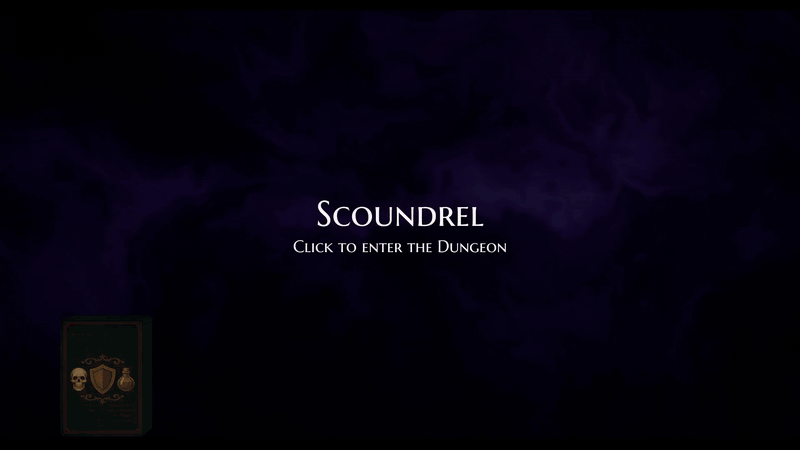

# Scoundrel

My take on [Scoundrel](http://stfj.net/art/2011/Scoundrel.pdf), the single-player rogue-like card game by Zach Gage and Kurt Bieg. You go down a Dungeon made of a standard deck of cards: fight monsters, equip weapons and drink potions, and try to get to the bottom alive.

## How to build

### Requirements

- **GPU:** OpenGL 4.6 with `GL_ARB_bindless_texture`. All textures are drawn through bindless handles, so the game does not run without it.
  - Most NVIDIA and AMD GPUs, and recent Intel GPUs with up-to-date drivers, support it.
  - It is not available on macOS.
  - To check your GPU, look for `GL_ARB_bindless_texture` in the extension list of [GPU Caps Viewer](https://www.geeks3d.com/gpucapsviewer/) (Windows) or run `glxinfo | grep bindless` (Linux).
- **Compiler:** Clang. Windows uses `clang-cl` (LLVM) together with the Visual Studio build tools.

All other libraries (SDL3, glad, glm, stb, json.h) are in `libraries/`.

### Windows

1. Open a **Developer Command Prompt for Visual Studio** (it sets up the linker and the Windows SDK). Make sure that `clang-cl` is on the `PATH` (`C:\Program Files\LLVM\bin`).
2. Build SDL3 one time, so `SDL3.lib` and `SDL3.dll` are in `libraries\SDL-release-3.4.8\Release\`:
   ```
   cd libraries\SDL-release-3.4.8
   cmake -S . -B . && cmake --build . --config Release
   ```
3. From the project root, run:
   ```
   build.bat
   ```
4. The first time, copy `libraries\SDL-release-3.4.8\Release\SDL3.dll` into `build\`.
5. Run `build\scoundrel.exe` from inside `build\`, so that it finds `assets\` and `shaders\`.

### Linux

1. Build SDL3 one time, so `libSDL3.so` is in `libraries/SDL-release-3.4.8/`:
   ```
   cd libraries/SDL-release-3.4.8
   cmake -S . -B . -DCMAKE_BUILD_TYPE=Release && cmake --build . -j
   ```
2. From the project root, run:
   ```
   ./build.sh
   ```
3. Run `./scoundrel` from inside `build/`.

The build scripts copy `assets/` and `src/shaders/` into `build/` on every build.

### Troubleshooting

- **`glad.c` fails with `-Wunused-but-set-global`:** newer Clang versions warn about a variable inside glad, and `-Werror` makes the warning an error. Add `-Wno-unused-but-set-global` to the compile line in the build script.
- **Windows blocks `scoundrel.exe`** ("blocked by your organization's Device Guard policy"): Smart App Control rejects programs that are not signed. You cannot turn it off for one program, only in Windows Security, under App & browser control.

## How to play

### The cards

The Dungeon is a deck of 44 cards: a standard deck without the jokers, the red face cards and the red aces.

| Cards | Type | Effect |
| --- | --- | --- |
| ♣ Clubs and ♠ Spades (2 to Ace) | Monsters | Do damage equal to their value (J = 11, Q = 12, K = 13, A = 14) |
| ♦ Diamonds (2 to 10) | Weapons | Lower the damage of the monsters you fight with them |
| ♥ Hearts (2 to 10) | Health potions | Give back health equal to their value |

You start with 20 health, and you cannot go above 20.

### A turn

1. Four cards are dealt from the Dungeon to make a **Room**.
2. Face 3 of the 4 cards, one at a time, in the order you want. The last card stays and becomes part of the next Room.
3. Before you face a card, you can **skip** the Room: its 4 cards go to the bottom of the Dungeon and a new Room is dealt. You cannot skip two Rooms in a row.

### Facing cards

- **Weapon:** you equip it. Your old weapon and the monsters it killed go to the discard pile.
- **Potion:** you heal by its value. Only one potion per Room heals, and a second one in the same Room is discarded with no effect.
- **Monster with a weapon:** you take the monster value minus the weapon value as damage (never below 0). After a weapon kills a monster, you can only use it on monsters with a lower value than the last one it killed.
- **Monster barehanded:** you take the full monster value as damage.

### Controls

| Input | Action |
| --- | --- |
| Left click on the start screen | Start the game |
| Left click on a Room card | Face the card (monsters are fought with your weapon, if it can be used) |
| Right click on a Room card | Fight the monster barehanded |
| Click on the Dungeon | Skip the Room |
| R | Play again, after a win or a loss |
| Alt + Enter | Fullscreen on or off |
| Esc | Quit |

### Score

- **You die** when your health gets to 0 or less. Your score is your health minus the value of every monster still in the Dungeon and in the Room.
- **You win** when you get through all the Dungeon. Your score is your health. If your health is 20 and the last card you faced was a potion, the value of that potion is added to your score.

## License

[Beerware](LICENSE)
